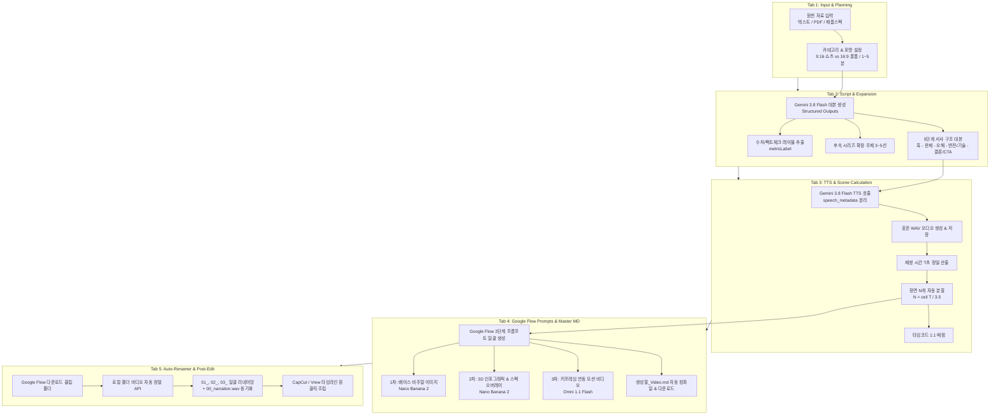

# 🚀 AI Video Pipeline Studio: 상세 개발 계획서 (Development Master Plan)

본 문서는 다양한 주제(제품, 서비스, IT/테크, 지식/교양, 건축/공학 등)의 원천 자료를 입력받아 **1~5분 분량의 쇼츠(9:16) 및 롱폼(16:9) 영상 제작 파이프라인을 자동화**하는 웹 애플리케이션의 단계별 상세 개발 계획서입니다.

---

## 1. 시스템 아키텍처 및 파이프라인 흐름 (System Architecture)



---

## 2. 전역 데이터 모델 정의 (`types/video-project.ts`)

```typescript
export type VideoCategory = 
  | 'product'     // 제품 홍보
  | 'service'     // 서비스 소개
  | 'tech'        // IT·테크 리뷰
  | 'knowledge'   // 지식·백과·교양
  | 'architecture'// 건축·공학
  | 'general';    // 기타 범용

export type AspectRatio = '9:16' | '16:9';

export type NarrativeStage = 
  | 'hook'        // 0~3초 오프닝 훅
  | 'problem'     // 문제 제기 / 페인포인트
  | 'misconception' // 원인 오해 / 기존 방식의 한계
  | 'solution'    // 반전 / 과학적·시각적 핵심 해결
  | 'conclusion'; // 결론 / 가치 요약 및 CTA

export interface VideoScene {
  id: string;
  sceneNumber: number; // 1, 2, 3...
  timecode: string;    // 예: "00:00 ~ 00:03.5"
  startSeconds: number;
  endSeconds: number;
  stage: NarrativeStage;
  script: string;      // 순수 나레이션 대본
  speechStyle: string; // 예: "curious and energetic", "calm and authoritative"
  metricLabel: string; // 예: "무게 1.2kg", "처리속도 3배↑", "7cm 오차"
  basePrompt: string;  // 1차 순수 배경/제품 이미지 프롬프트 (Nano Banana 2)
  infographicPrompt: string; // 2차 3D 인포그래픽 오버레이 프롬프트 (Nano Banana 2)
  motionPrompt: string;      // 3차 동영상 모션 프롬프트 (Omni 1.1 Flash)
}

export interface TopicExpansion {
  id: string;
  title: string;
  summary: string;
  targetDuration: string;
}

export interface VideoProject {
  id: string;
  title: string;
  category: VideoCategory;
  aspectRatio: AspectRatio;
  targetDurationSeconds: number; // 목표 시간 (60 ~ 300초)
  sourceContent: string;
  keyHighlights?: string;
  
  // Tab 2: 대본 및 확장 주제
  scenes: VideoScene[];
  topicExpansions: TopicExpansion[];
  
  // Tab 3: TTS 오디오 및 정밀 분석
  ttsVoice: string; // "Kore", "Aoede", "Achird" 등
  audioUrl?: string;
  actualAudioDurationSeconds?: number;
  secondsPerScene: number; // 기본값 3.5초 (3~5초 조절 가능)
  totalScenes: number;
  
  // Tab 4: 글로벌 비주얼 메타데이터
  globalVisualStyle: string;
  videoClipDuration: number; // 4, 8, 10초
  generatedMarkdown?: string;
  
  // 상태 관리
  currentStep: number; // 1 ~ 5
  updatedAt: string;
  createdAt: string;
}
```

---

## 3. 단계별 상세 개발 계획 (Phase 1 ~ Phase 5)

### 📍 [Phase 1] 프로젝트 스캐폴딩 및 워크스페이스 UI 구축

#### 🎯 목표
Next.js (App Router), TypeScript, Tailwind CSS, 최신 `@google/genai` 환경을 셋업하고 5단계 스텝 위저드(Step Wizard) 워크스페이스 레이아웃과 프로젝트 로컬 저장소를 완성합니다.

#### 🛠 주요 구현 내역
1. **프로젝트 환경 초기화**:
   - Next.js (App Router), TypeScript, Tailwind CSS, Lucide React 설치
   - 최신 Google GenAI SDK (`@google/genai`) 연동 준비
   - `.env.example` 및 `.env.local` 셋업 가이드 생성 (`GEMINI_API_KEY`)
2. **5단계 파이프라인 탭 대시보드 UI**:
   - **사이드바**: 프로젝트 목록 관리 (신규 프로젝트, 프로젝트 복제/삭제, 로컬 저장 프로젝트 로드), API 키 연동 상태 배지
   - **메인 위저드 탭 구성**:
     - `Tab 1`: 원천 자료 입력 & 기획 설정 (카테고리, 비율 9:16/16:9, 길이 1~5분 슬라이더, 텍스트/스펙 입력)
     - `Tab 2`: 대본 작성 & 팩트체크 & 주제 확장
     - `Tab 3`: Gemini 3.8 TTS 생성 & 장면 자동 계산
     - `Tab 4`: Google Flow 3단계 프롬프트 & `생성할_Video.md` 추출
     - `Tab 5`: 다운로드 비디오(`01_`, `02_`) 자동 정렬 유틸리티
3. **상태 관리 및 로컬 저장소 구축**:
   - `localStorage` 기반 프로젝트 자동 임시저장
   - 서버 로컬 파일시스템 (`/projects/[project_id]/`) 연동용 저장 모듈 구축

#### ✅ 검증 기준
- [ ] 브라우저에서 5개 탭 간 자유로운 전환 및 상태 유지 확인
- [ ] 프로젝트 생성, 제목 변경, 카테고리/길이 설정 시 로컬 스토리지에 동기화
- [ ] 반응형 다크 테마 및 깔끔한 스튜디오 레이아웃 렌더링 확인

---

### 📍 [Phase 2] 원천 자료 분석, 5단계 서사 대본 및 주제 확장 엔진

#### 🎯 목표
원천 자료를 Gemini 3.8 Flash에 입력하여 팩트 체크된 1~5분 분량의 5단계 서사 대본과 3~5개의 연관 후속 주제를 구조화된 JSON(Structured Outputs)으로 생성하는 백엔드/프론트엔드 연동.

#### 🛠 주요 구현 내역
1. **대본 생성 API (`/api/generate-script/route.ts`)**:
   - 모델: `gemini-3.8-flash`
   - `@google/genai`의 `responseSchema`를 활용한 엄격한 JSON 스키마 적용
   - 한국어 발화 기준(1분당 약 250~300자) 길이 정밀 제어
   - **도메인별 5단계 서사 구조 강제**:
     1. 3초 오프닝 훅 (시청자 이탈 방지 강렬한 질문/충격적 수치)
     2. 문제 발생 / 페인포인트
     3. 원인 오해 / 기존 통념의 한계
     4. 반전 / 과학적·시각적 기술 해결 (핵심 수치 필수 포함)
     5. 결론 및 가치 요약 (CTA)
   - **수치 팩트체크 및 시각 레이블 (`metricLabel`)**: 원천 자료의 스펙/수치를 왜곡 없이 추출
   - **주제 확장 (Topic Expansion)**: 3~5개의 후속 시리즈 기획안 및 요약 자동 도출
2. **Tab 2 인터랙티브 대본 에디터 UI**:
   - 서사 단계별 카드/테이블 뷰 제공 (대본 실시간 수정 가능)
   - 감정/톤 지시어(`speechStyle`) 원클릭 프리셋 버튼
   - 인라인 호흡 태그(`<short pause>`, `<breath>`) 원클릭 삽입 버튼
   - 연관 확장 주제 카드 뷰 및 '이 주제로 새 프로젝트 시작' 버튼

#### ✅ 검증 기준
- [ ] 원천 자료 입력 시 5단계 서사 구조가 엄격히 반영된 대본 JSON 수신
- [ ] 각 장면에 정확한 `metricLabel`과 `speechStyle`이 배정되는지 확인
- [ ] 후속 확장 주제 3~5개가 정상 출력되고 즉시 신규 프로젝트로 연결되는지 검증

---

### 📍 [Phase 3] Gemini 3.8 Flash TTS 연동 및 음성 길이 기반 장면 계산기

#### 🎯 목표
최신 Gemini 3.8 TTS API 규격(`speech_metadata` 분리, 헤더 포함 WAV)을 적용하여 나레이션을 생성하고, 실측 오디오 재생 시간(초)을 기반으로 필요한 장면(Scene) 개수를 자동 분할.

#### 🛠 주요 구현 내역
1. **Gemini 3.8 TTS 음성 합성 API (`/api/generate-tts/route.ts`)**:
   - 모델: `gemini-3.8-flash-tts` (고품질) 또는 `gemini-3.8-flash-lite-tts` (고속)
   - **스키마 준수**:
     - `text`는 순수 대본 + 꺾쇠 태그만 전달 (프롬프트성 지시문 제거)
     - `annotations: [{ type: "speech_metadata", speaker: "...", style: "..." }]` 전달
   - Unary 요청으로 반환된 표준 WAV base64 데이터를 `/public/projects/[id]/narration.wav`에 저장
   - 오디오 버퍼 분석을 통한 정밀 재생 시간(초, 소수점 1자리) 산출
   - 외부 TTS 오디오(.mp3, .wav) 파일 직접 업로드 및 길이 자동 추출 기능 지원
2. **장면(Scene) 자동 계산 및 분할 알고리즘**:
   - 공식: $N = \lceil T / 3.5 \rceil$ (사용자가 3.0~5.0초 조절 가능)
   - 나레이션 대본을 $N$개 구간으로 문맥 단위 균등 분할
   - 각 장면에 타임코드(예: `00:00 ~ 00:03.5`, `00:03.5 ~ 00:07.0`) 자동 할당
3. **Tab 3 오디오 플레이어 & 타임라인 UI**:
   - 오디오 파형/재생 컨트롤러, 총 재생 시간 및 총 장면 수 요약 배지
   - 장면 병합(Merge) / 분할(Split) 기능이 포함된 시각적 타임라인

#### ✅ 검증 기준
- [ ] Gemini 3.8 TTS 생성 후 `.wav` 파일 재생 및 정확한 초 단위 길이 산출 확인
- [ ] 총 재생 시간에 비례하여 장면 개수가 정확하게 자동 분할되는지 검증
- [ ] 타임코드와 나레이션이 1:1 매핑되어 타임라인에 표시되는지 확인

---

### 📍 [Phase 4] Google Flow 3단계 프롬프트 일괄 생성기 및 `생성할_Video.md` 내보내기

#### 🎯 목표
분할된 장면에 대해 Nano Banana 2 및 Omni 1.1 Flash 모델에 최적화된 3단계 프롬프트를 일괄 생성하고, 마스터 매뉴얼 파일(`[프로젝트명]_Video.md`)을 자동 생성 및 다운로드 지원.

#### 🛠 주요 구현 내역
1. **3단계 프롬프트 일괄 생성 API (`/api/generate-flow-prompts/route.ts`)**:
   - **1차 (Base Visual - Nano Banana 2)**: 텍스트/화살표 없는 순수 고화질 3D/시네마틱 배경 및 오브젝트 이미지 프롬프트
   - **2차 (Infographic Overlay - Nano Banana 2)**: 1차 베이스 이미지 위에 굵은 3D 입체 화살표, 계측선, `metricLabel`, 한글 스펙 레이블을 입체 배치하는 프롬프트
   - **3차 (Motion Video - Omni 1.1 Flash)**: 1차와 2차 이미지를 키프레임 결합하여 카메라 워크(Pan, Push-in 클로즈업), 유체/작동 모션 및 `@image` 연속성 태깅을 포함한 비디오 프롬프트
2. **마크다운 마스터 파일 생성 엔진 (`lib/markdown-generator.ts`)**:
   - `project_video.md` 템플릿 규격에 따라 메타데이터, 타임코드 매핑표, Step 1~3 전체 일괄 복사용 코드 블록, 확장 주제를 자동 조합
   - 웹앱 미리보기 및 즉시 `.md` 파일 다운로드 지원
   - 서버의 로컬 프로젝트 폴더에도 자동 저장
3. **Tab 4 원클릭 복사 & 뷰어 UI**:
   - `[초반 3개 장면 테스트용 프롬프트 복사]` 버튼 (크레딧 절약)
   - `[Step 1 베이스 이미지 일괄 복사]`, `[Step 2 인포그래픽 일괄 복사]`, `[Step 3 모션 비디오 일괄 복사]` 버튼
   - `[📄 생성할_Video.md 다운로드]` 버튼

#### ✅ 검증 기준
- [ ] 생성된 프롬프트가 Google Flow 규격에 부합하며 1차/2차/3차가 유기적으로 연계되는지 확인
- [ ] 초반 3개 장면 테스트 복사 블록이 올바르게 추출되는지 검증
- [ ] `생성할_Video.md`가 표준 템플릿 규격 그대로 빈틈없이 다운로드되는지 확인

---

### 📍 [Phase 5] 다운로드 비디오(`01_`, `02_`) 자동 순서 정렬기 및 최종 편집 연동

#### 🎯 목표
Google Flow에서 렌더링된 무작위 파일명의 `.mp4` 클립들을 대본 순서(`01_`, `02_`, `03_`)로 자동 리네이밍하여 CapCut / Vrew에 바로 드래그앤드롭할 수 있도록 연동.

#### 🛠 주요 구현 내역
1. **로컬 폴더 비디오 자동 정렬 API (`/api/rename-videos/route.ts`)**:
   - 사용자가 지정한 로컬 다운로드 폴더 내의 `.mp4`, `.png`, `.jpg` 목록 스캔
   - 파일 생성 시간순, 키워드 매칭, 또는 UI 드래그앤드롭 순서로 `Scene 01 ~ Scene N`과 매칭
   - 일괄 리네이밍 실행 (`01_Scene01_훅.mp4`, `02_Scene02_문제.mp4` ...)
   - 동일 폴더로 `00_narration.wav`와 `생성할_Video.md` 자동 복사
2. **Tab 5 매칭 보드 & 편집 SOP 체크리스트 UI**:
   - 좌측 대본 장면 리스트 vs 우측 비디오 클립 썸네일 카드의 매칭 뷰어
   - CapCut / Vrew 원클릭 편집 워크플로우 가이드 표시 (A-Z 정렬 ➔ 오디오 배치 ➔ 자동 자막)

#### ✅ 검증 기준
- [ ] 로컬 폴더 경로 입력 시 파일 목록이 정상 로드되고 씬과 1:1 매칭되는지 확인
- [ ] 리네이밍 실행 시 파일명 접두사(`01_`, `02_`...)가 안전하게 변경되는지 확인
- [ ] `00_narration.wav` 및 매뉴얼 파일이 함께 저장되는지 확인

---

## 4. 파일 및 디렉토리 구조 계획 (Project File Structure)

```text
video_generator/
├── GEMINI.md                    # Antigravity 지침 및 프로젝트 핵심 규칙
├── DEVELOPMENT_PLAN.md          # 상세 개발 계획서 (본 파일)
├── project_video.md             # 생성할_Video.md 표준 템플릿 규격
├── SOP_WORKFLOW.md              # 실전 운영 매뉴얼 및 크레딧 절약 가이드
├── package.json                 # Next.js, @google/genai, Tailwind, Lucide
├── tsconfig.json
├── tailwind.config.js
├── .env.example                 # GEMINI_API_KEY 템플릿
├── .env.local                   # 로컬 API 키 (Git 제외)
├── app/
│   ├── layout.tsx               # 루트 레이아웃 & 테마 공급자
│   ├── page.tsx                 # 메인 스튜디오 대시보드 (5-Step Wizard 통합)
│   ├── globals.css              # 모던 글래스모피즘 및 다크 UI 스타일
│   └── api/
│       ├── generate-script/route.ts       # Phase 2: 대본 & 팩트체크 & 주제 확장
│       ├── generate-tts/route.ts          # Phase 3: Gemini 3.8 TTS & 재생시간 분석
│       ├── generate-flow-prompts/route.ts # Phase 4: Google Flow 3단계 프롬프트 일괄 생성
│       └── rename-videos/route.ts         # Phase 5: 로컬 비디오 일괄 넘버링 & 파일 복사
├── components/
│   ├── layout/
│   │   ├── Sidebar.tsx          # 프로젝트 목록 & 전역 설정
│   │   └── StepHeader.tsx       # 5단계 파이프라인 진행 상태 바
│   ├── steps/
│   │   ├── Step1Planning.tsx    # 원천자료 입력 & 카테고리/길이 설정
│   │   ├── Step2Script.tsx      # 5단계 서사 대본 에디터 & 주제 확장
│   │   ├── Step3TTS.tsx         # TTS 오디오 플레이어 & 씬 분할 타임라인
│   │   ├── Step4Prompts.tsx     # Google Flow 3단계 복사 & MD 뷰어
│   │   └── Step5Renamer.tsx     # 비디오 순서 정렬 & CapCut 연동 매칭 보드
│   └── ui/                      # 버튼, 모달, 슬라이더, 카드 등 재사용 UI
├── lib/
│   ├── gemini-client.ts         # 최신 @google/genai SDK 클라이언트 초기화
│   ├── markdown-generator.ts    # 생성할_Video.md 마크다운 컴파일러
│   ├── audio-analyzer.ts        # WAV 헤더/재생 시간 정밀 파서
│   └── project-store.ts         # localStorage & 서버 파일 연동 상태 관리
├── types/
│   └── video-project.ts         # 전역 프로젝트 및 씬 데이터 타입 정의
└── public/
    └── projects/                # 생성된 프로젝트별 오디오 및 에셋 저장소
```

---

## 5. 단계별 실행 가이드 (Implementation Roadmap)

개발은 **Phase 1부터 순차적으로 진행**하며, 각 단계 완료 후 브라우저와 API 정상 작동을 확인한 뒤 다음 단계로 넘어갑니다.

| 단계 | 핵심 작업 | 산출물 |
| :--- | :--- | :--- |
| **Phase 1** | 프로젝트 스캐폴딩 & UI 대시보드 | Next.js 셋업, 5-Tab 위저드 UI, 프로젝트 스토어, 타입 정의 |
| **Phase 2** | 대본 및 주제 확장 엔진 | `/api/generate-script`, Structured JSON 대본, Tab 2 에디터 |
| **Phase 3** | Gemini 3.8 TTS & 씬 계산기 | `/api/generate-tts`, WAV 시간 측정, 씬 분할 알고리즘, Tab 3 타임라인 |
| **Phase 4** | Google Flow 3단계 프롬프트 & MD | `/api/generate-flow-prompts`, `생성할_Video.md`, 원클릭 복사 UI |
| **Phase 5** | 비디오 자동 정렬 & 후반 편집 연동 | `/api/rename-videos`, 파일 매칭 보드, CapCut/Vrew 연동 |
